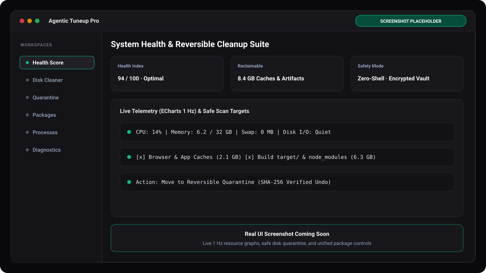
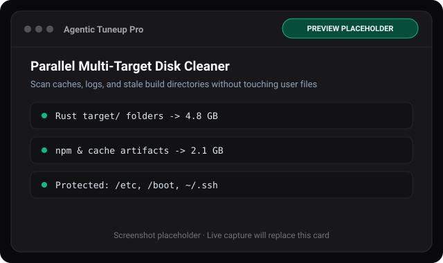
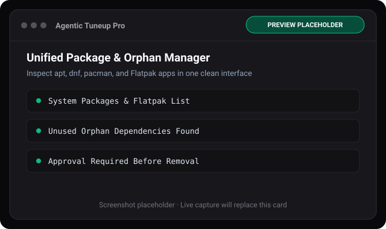
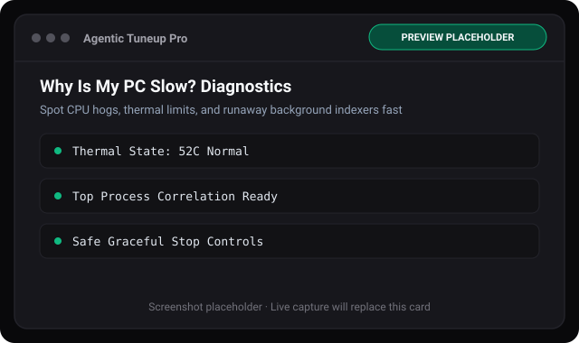
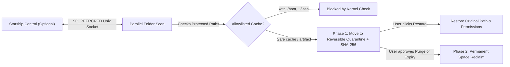
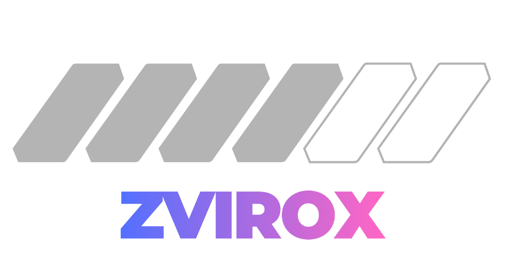

<div align="center">
  <a id="top"></a>
  <p>
    
  </p>

  <h1>Agentic Tuneup Pro</h1>

  <h3>Safety-first Linux system cleaner, package manager, and health monitor</h3>

  <p>
    Reclaim disk space safely with a reversible SHA-256 quarantine, manage system packages in one view, and watch live system health without risky shell scripts.
  </p>

  <p>
    <a href="https://zvirox.in/projects/atp/">Project Page</a> ·
    <a href="https://zvirox.in/downloads/atp/">Download Packages</a> ·
    <a href="https://github.com/zvirox/agentic-tuneup-pro/releases">GitHub Releases</a> ·
    <a href="#quick-installation">Quick Install</a> ·
    <a href="#core-safety-principles">Safety Rules</a> ·
    <a href="#starship-control-integration">Starship Control</a> ·
    <a href="#maintainer-and-ecosystem">Maintainer</a> ·
    <a href="#frequently-asked-questions">FAQ</a>
  </p>

  <p>
    <a href="https://zvirox.in/downloads/atp/">
      
    </a>
    <a href="https://github.com/zvirox/agentic-tuneup-pro/actions/workflows/ci.yml">
      
    </a>
    <a href="LICENSE">
      
    </a>
    
    
  </p>

  <table>
    <tr>
      <td align="right"><b>Start</b></td>
      <td align="center"><a href="#what-is-agentic-tuneup-pro">What It Is</a></td>
      <td align="center"><a href="#workspace-previews">Previews</a></td>
      <td align="center"><a href="#quick-installation">Install</a></td>
    </tr>
    <tr>
      <td align="right"><b>Safety &amp; Features</b></td>
      <td align="center"><a href="#core-safety-principles">Safety Principles</a></td>
      <td align="center"><a href="#key-features">Key Capabilities</a></td>
      <td align="center"><a href="#tech-stack">Tech Stack</a></td>
    </tr>
    <tr>
      <td align="right"><b>Automation</b></td>
      <td align="center"><a href="#starship-control-integration">Starship Control</a></td>
      <td align="center"><a href="#real-world-use-cases">Use Cases</a></td>
      <td align="center"><a href="#how-connection-works">Socket Setup</a></td>
    </tr>
    <tr>
      <td align="right"><b>Community</b></td>
      <td align="center"><a href="#frequently-asked-questions">FAQ</a></td>
      <td align="center"><a href="#maintainer-and-ecosystem">Maintainer</a></td>
      <td align="center"><a href="#license">License</a></td>
    </tr>
  </table>
</div>

<br />

<p align="center">
  
  <br />
  <sub><b>Screenshot placeholder.</b> System Health Dashboard displaying 1 Hz live resource charts and safe scan targets.</sub>
</p>

---

## What is Agentic Tuneup Pro?

Most Linux system cleaners permanently delete files using fragile shell scripts. One wrong wildcard or hurried click can wipe out active project caches or break system configuration files with zero undo path.

Agentic Tuneup Pro is built around strict reversible safety. Its visual dashboard shows live CPU, memory, thermal, and disk trends alongside package lists and process trees. Cleaned files are moved into an encrypted local quarantine vault instead of being erased right away. If any application still needs a file, you can restore it in one click with verified byte-for-byte accuracy.

---

## Workspace Previews

<table>
  <tr>
    <td width="50%" valign="top">
      <br />
      <strong>Parallel Disk Cleaner</strong><br />
      Scans browser caches, system logs, Python environments, <code>node_modules/</code>, and Rust <code>target/</code> folders safely in parallel.
    </td>
    <td width="50%" valign="top">
      <br />
      <strong>Reversible Quarantine Vault</strong><br />
      Restores past cleanup sessions bit-for-bit using SHA-256 verification and automatic retention timers.
    </td>
  </tr>
  <tr>
    <td width="50%" valign="top">
      <br />
      <strong>Unified Package Manager</strong><br />
      Inspects <code>apt</code>, <code>dnf</code>, <code>pacman</code>, and Flatpak apps in one calm list and flags leftover orphan dependencies.
    </td>
    <td width="50%" valign="top">
      <br />
      <strong>Slowdown Diagnostics</strong><br />
      Matches thermal throttling, high CPU load, and background disk indexers so you know why your fans sped up.
    </td>
  </tr>
</table>

---

## Core Safety Principles

| Safety Guarantee | How It Works | What It Prevents |
| :--- | :--- | :--- |
| **Zero Direct Deletions** | Cleaned files move to a reversible quarantine folder first | Accidental permanent loss of needed caches or builds |
| **Zero-Shell Execution** | All actions run through direct Rust OS calls without `sh -c` | Command injection or broken path expansion bugs |
| **Hard Protected Paths** | Component-aware checks block `/etc`, `/boot`, `/usr`, `/dev`, SSH keys, and vaults | System damage or credential deletion |
| **Honest Error Reporting** | In-app IPC (`safeInvoke`) surfaces real backend failures and avoids silent fake successes | Masked backend errors disguised as completed actions |

---

## Key Features

- **Parallel Multi-Target Scanner**: Finds browser caches, old developer build folders (`target/`, `node_modules/`, Python venvs), and temporary logs fast without stalling the interface.
- **Two-Phase Reversible Quarantine**: Keeps every cleaned item recoverable with original path permissions and SHA-256 checksum verification until your chosen expiry timer runs out.
- **Unified Linux Package View**: Shows native system packages (`apt`, `dnf`, `pacman`), Flatpaks, and AppImages side by side *(package mutations currently show plan previews pending D-Bus helper execution wiring)*.
- **Process and Service Explorer**: Displays active apps grouped by process tree with real-time CPU and RAM readouts and graceful stop actions.
- **"Why Is My PC Slow?" Diagnostics**: Correlates temperature sensors, memory pressure, and background indexers into clear plain-English findings.
- **1 Hz Live Telemetry**: Smooth Apache ECharts gauges track CPU, memory, disk I/O, and a 100-point composite health index.

---

## How Safety Quarantine Works



---

## Starship Control Integration

Agentic Tuneup Pro runs completely as a standalone desktop application. You can scan, clean, inspect processes, and manage packages without installing anything else.

To unlock natural-language maintenance, Agentic Tuneup Pro links directly with [Starship Control](https://github.com/zvirox/starship-control) ([Releases](https://github.com/zvirox/starship-control/releases)), the optional Linux desktop AI assistant.

### Why It Exists

Remembering distro package flags, hunting down hidden cache folders, and digging through process trees takes effort. Pairing Agentic Tuneup Pro with Starship Control lets you ask ordinary questions about your computer health while keeping full human confirmation before anything changes.

### Real-World Use Cases

- **Instant Slowdown Check**: Ask Starship Control *"Why is my laptop fan spinning so loudly right now?"* The agent inspects live CPU load, temperatures, and heavy background tasks for you.
- **Developer Storage Recovery**: Say *"Find old build directories in my Projects folder untouched for 30 days and move them to quarantine for review."*
- **Weekly Package Hygiene**: Ask *"Check my system packages for unused orphan dependencies and show me the list before removing anything."*

### How Connection Works

Setup runs automatically on your local machine:

1. **Local Discovery**: Agentic Tuneup Pro registers its plugin descriptor in `$XDG_DATA_HOME/starship/plugins/atp.json` when opened.
2. **Private Unix Socket**: Data and plans travel across `$XDG_RUNTIME_DIR/starship/bridges/atp.sock`.
3. **Kernel User Verification**: Connections check Linux peer credentials (`SO_PEERCRED`). Only processes running as your logged-in user ID can talk to the tool. Zero network ports open.
4. **Instant Assistant Access**: Press `Super+Shift+Space` to summon Starship Control and manage your machine safely. For downloads and setup details, visit the [Starship Control repository](https://github.com/zvirox/starship-control) and [releases](https://github.com/zvirox/starship-control/releases).

---

## Quick Installation

Prebuilt Linux packages and checksum files are published on the [Releases page](https://github.com/zvirox/agentic-tuneup-pro/releases).

| Distribution | Package Format | Install Command |
| :--- | :--- | :--- |
| **Debian / Ubuntu / Pop!_OS / Mint** | `.deb` | `sudo apt install ./agentic-tuneup-pro_*_amd64.deb` |
| **Fedora / RHEL / openSUSE** | `.rpm` | `sudo dnf install ./agentic-tuneup-pro-*.x86_64.rpm` |
| **Arch Linux / Manjaro / CachyOS** | `.pkg.tar.zst` | `sudo pacman -U ./agentic-tuneup-pro-*-x86_64.pkg.tar.zst` |

<details>
<summary><strong>Verify Checksums and Build From Source</strong></summary>

Verify downloaded files using `SHA256SUMS`:

```bash
sha256sum -c SHA256SUMS --ignore-missing
```

To build directly from source, install Rust stable, Node.js 22+, and standard Linux desktop dependencies (`libwebkit2gtk-4.1-dev`, `libgtk-3-dev`, `libayatana-appindicator3-dev`, `libssl-dev`, `pkg-config`):

```bash
git clone https://github.com/zvirox/agentic-tuneup-pro.git
cd agentic-tuneup-pro
cd app && npm ci && npm run check:linear && npm run build && cd ..
cargo test --workspace
cargo build --release -p agentic-tuneup-pro -p atpd-helper
```

</details>

Official Linux releases ship exclusively as native `.deb`, `.rpm`, and `.pkg.tar.zst` packages alongside `SHA256SUMS`. Legacy AppImage, Flatpak, tarball, and AUR packages are retired and no longer updated.

---

## Tech Stack

| Layer | Technology | Role |
| :--- | :--- | :--- |
| **System Core** | Rust 2024 Workspace | Zero-shell scanners, SHA-256 quarantine, and telemetry sampler |
| **Desktop Shell** | Tauri 2 | Native Linux windowing and scoped permission dialogs |
| **Frontend UI** | React 19 + TypeScript + Tailwind CSS v4 + Inter | Solid matte Dark & Light Linear UI (`check:linear` gated) with `Ctrl+K` quick actions |
| **Charts and State** | Apache ECharts 6 + Zustand | Live 1 Hz CPU, memory, and disk usage visualizations |
| **Automation Bridge** | `starship-plugin` SDK | Authenticated local Unix socket commands for Starship Control |

---

## Frequently Asked Questions

**Can Agentic Tuneup Pro accidentally break my Linux installation?**
No. Protected system directories (`/etc`, `/boot`, `/usr`) and sensitive folders such as SSH keys are hardcoded as off-limits. Cleanups also move files into a reversible quarantine vault instead of erasing them directly.

**Does the app need root administrator rights?**
Everyday cleanup of browser caches and developer build folders works with standard user permissions. Only administrative actions such as system package removal request standard Linux authorization.

**Is Starship Control mandatory?**
No. Agentic Tuneup Pro works completely on its own with a full visual interface. Starship Control is optional if you prefer voice or natural-language automation.

**How do I bring back a quarantined file?**
Open the Quarantine tab, find your cleanup session or individual file, and click **Restore**. The file returns to its exact original folder and permissions.

---

## Maintainer and Ecosystem

<p align="center">
  <a href="https://www.zvirox.in">
    
  </a>
</p>

<p align="center">
  <strong>Prakashpuri Gauswami (<a href="https://github.com/zvirox">@zvirox</a>)</strong><br />
  Cybersecurity Analyst &amp; SOC Practitioner · Agentic AI Builder · Blue Team &amp; SIEM · Patan, Gujarat, India
</p>

<p align="center">
  <a href="https://github.com/sponsors/zvirox">
    
  </a>
  <a href="https://ko-fi.com/zvirox">
    
  </a>
</p>

I build local-first open-source Linux and Android tools under **Zvirox**. Writing real software helps me study system boundaries and security architecture hands-on while giving creators and Linux users fast desktop tools free from subscriptions and telemetry.

### Connect and Support

- **GitHub Profile**: [github.com/zvirox](https://github.com/zvirox)
- **Website**: [www.zvirox.in](https://www.zvirox.in)
- **Email**: [info@zvirox.in](mailto:info@zvirox.in)
- **Sponsor**: [GitHub Sponsors](https://github.com/sponsors/zvirox) · [Ko-fi](https://ko-fi.com/zvirox)
- **Socials**: [LinkedIn (`in/plgsevala`)](https://www.linkedin.com/in/plgsevala) · [YouTube (`@zvirox_in`)](https://www.youtube.com/@zvirox_in) · [Instagram (`plg.sevala`)](https://www.instagram.com/plg.sevala) · [Facebook (`plg.sevala`)](https://www.facebook.com/plg.sevala)

### Zvirox App Suite (Open-Source Project List)

All six applications in the Zvirox desktop suite work standalone and connect together through Starship Control:

| Logo | Application | Purpose | Repository | Download & Project |
| :---: | :--- | :--- | :--- | :--- |
|  | **[Starship Control](https://zvirox.in/projects/sc/)** | Local-first AI desktop cockpit and floating HUD | [github.com/zvirox/starship-control](https://github.com/zvirox/starship-control) | [Download](https://zvirox.in/downloads/sc/) · [Releases](https://github.com/zvirox/starship-control/releases) |
|  | **[Screen Studio Pro](https://zvirox.in/projects/ssp/)** | Wayland and X11 screen recorder with PipeWire | [github.com/zvirox/screen-studio-pro](https://github.com/zvirox/screen-studio-pro) | [Download](https://zvirox.in/downloads/ssp/) · [Releases](https://github.com/zvirox/screen-studio-pro/releases) |
|  | **[Easy Edits Pro](https://zvirox.in/projects/eep/)** | Non-destructive multitrack video editor | [github.com/zvirox/easy-edits-pro](https://github.com/zvirox/easy-edits-pro) | [Download](https://zvirox.in/downloads/eep/) · [Releases](https://github.com/zvirox/easy-edits-pro/releases) |
|  | **[Audio Labs Pro](https://zvirox.in/projects/alp/)** | Offline voice studio and multitrack audio editor | [github.com/zvirox/audio-labs-pro](https://github.com/zvirox/audio-labs-pro) | [Download](https://zvirox.in/downloads/alp/) · [Releases](https://github.com/zvirox/audio-labs-pro/releases) |
|  | **[Agentic Tuneup Pro](https://zvirox.in/projects/atp/)** | Safety-first disk cleaner and system optimizer | [github.com/zvirox/agentic-tuneup-pro](https://github.com/zvirox/agentic-tuneup-pro) | [Download](https://zvirox.in/downloads/atp/) · [Releases](https://github.com/zvirox/agentic-tuneup-pro/releases) |
|  | **[Net Watch Pro](https://zvirox.in/projects/nwp/)** | Real-time network speed and per-app data tracker | [github.com/zvirox/net-watch-pro](https://github.com/zvirox/net-watch-pro) | [Download](https://zvirox.in/downloads/nwp/) · [Releases](https://github.com/zvirox/net-watch-pro/releases) |
| - | **[Your TV Friend](https://zvirox.in/projects/ytf/)** | Android TV non-destructive debloater and Your UI launcher | [github.com/zvirox/your-tv-friend](https://github.com/zvirox/your-tv-friend) | [Download APK](https://zvirox.in/downloads/ytf/) · [Releases](https://github.com/zvirox/your-tv-friend/releases) |

---

## Star History

<p align="center">
  <a href="https://www.star-history.com/#zvirox/agentic-tuneup-pro&Date">
    <picture>
      <source media="(prefers-color-scheme: dark)" srcset="https://api.star-history.com/svg?repos=zvirox/agentic-tuneup-pro&type=Date&theme=dark" />
      <source media="(prefers-color-scheme: light)" srcset="https://api.star-history.com/svg?repos=zvirox/agentic-tuneup-pro&type=Date" />
      
    </picture>
  </a>
</p>

---

## License

Agentic Tuneup Pro is free, open-source software licensed under the [GNU Affero General Public License v3.0](LICENSE).

<div align="center">
  <br />
  <a href="#top"><strong>Back to top</strong></a> · Built in public by <a href="https://www.zvirox.in">Zvirox</a>
</div>
