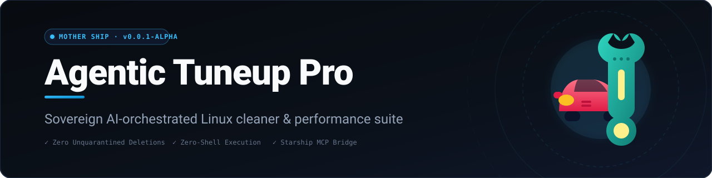

<p align="center">
  
</p>

# Agentic Tuneup Pro

Sovereign AI-orchestrated Linux cleaner, package manager, and performance suite.

<p align="center">
  
</p>

<p align="center">
  <a href="https://github.com/zvirox/agentic-tuneup-pro/releases"></a>
  <a href="LICENSE"></a>
  
  
  
</p>

**Agentic Tuneup Pro (ATP)** is a sovereign, safety-first desktop optimizer and [Model Context Protocol (MCP)](https://modelcontextprotocol.io) server built for Linux power users. Designed as the official system maintenance and performance companion of the **Mother Ship / Starship Control** ecosystem, ATP bridges high-performance native Rust system internals with interactive AI orchestration.

Most Linux cleaning tools rely on brittle shell scripts, delete files destructively without recovery options, or require unchecked root access. ATP redefines system maintenance around three foundational safety invariants: **Zero Unquarantined Deletions** (atomic staging with byte-parity rollback), **Strict Zero-Shell Execution** (direct binary calls via `tokio::process::Command`), and **Human-in-the-Loop Approval Gates** (signed consent cards before executing mutating actions).

---

## Table of Contents

- [Core Principles](#core-principles)
- [Key Features](#key-features)
- [Architecture](#architecture)
- [Installation](#installation)
  - [Arch Linux / AUR](#arch-linux--aur)
  - [Debian / Ubuntu / Pop!_OS (`.deb`)](#debian--ubuntu--pop_os-deb)
  - [Fedora / RHEL / openSUSE (`.rpm`)](#fedora--rhel--opensuse-rpm)
  - [Flatpak](#flatpak)
  - [Building from Source](#building-from-source)
- [Common Usage Guide](#common-usage-guide)
  - [Desktop GUI Cockpit](#desktop-gui-cockpit)
  - [In-App Starship Agent Drawer](#in-app-starship-agent-drawer)
  - [Headless MCP Server Mode](#headless-mcp-server-mode)
  - [Starship Control Bridge](#starship-control-bridge)
  - [Undoing Cleanup Sessions](#undoing-cleanup-sessions)
- [Security Model & Privileged Helper](#security-model--privileged-helper)
- [Common Troubleshooting](#common-troubleshooting)
- [Frequently Asked Questions (FAQ)](#frequently-asked-questions-faq)
- [Platform Support & Requirements](#platform-support--requirements)
- [Roadmap & Future Phases](#roadmap--future-phases)
- [Contributing](#contributing)
- [License](#license)

---

## Core Principles

1. **Zero Unquarantined Deletions** — No file is ever removed permanently during a clean operation. Every target is atomically staged into a secure local SQLite-backed quarantine store (`~/.local/share/atp/quarantine/`). Any cleanup can be rolled back with guaranteed byte-for-byte SHA-256 parity.
2. **Strict Zero-Shell Execution** — All system interactions, package queries, and process signals execute through direct OS binary calls (`tokio::process::Command::new(binary).args(...)`). Shell interpolation (`sh -c`) is prohibited across the entire codebase to eliminate command injection vulnerabilities.
3. **Signed Consent Gates (Tier 3)** — Low-risk queries execute autonomously; however, destructive operations (package uninstalls, process terminations, orphan prunes) strictly pause for explicit user consent via signed approval tokens (`usr_sig_*`).
4. **Hard Blacklist Defense** — System directories (`/etc`, `/boot`, `/usr`, `/proc`, `/sys`), user identity keys (`~/.ssh`, `~/.gnupg`, `keyrings`), and browser credential vaults (`Login Data*`, `logins.json`, `key4.db`) are unconditionally blocked by kernel-level canonicalization checks.

---

## Key Features

- **Parallel Multi-Target Disk Cleaner** — Concurrent parallel scanning across declarative TOML rules covering system caches, browser caches (Chrome, Firefox, Brave), developer build directories (`target/`, `node_modules/`, `.venv`), and package caches.
- **Two-Phase Reversible Quarantine Engine** — Atomic rollback with session tracking, automatic expiry policies, and cryptographic SHA-256 integrity verification.
- **Unified Package Manager (`atp-pkg`)** — Simultaneous lifecycle management across host-native package managers (`pacman`, `apt`, `dnf`), Flatpak container runtimes, and standalone AppImages, with zero-dependency orphan detection.
- **Process Tree & Systemd Service Explorer (`atp-procs`)** — Aggregated process trees grouped by application, responsive memory/CPU gauges, clean `SIGTERM` / `SIGKILL` tree termination, and systemd service control.
- **In-App Starship Agent Drawer** — Integrated 384px cockpit drawer toggleable via `Ctrl + Shift + A` or `Cmd + Shift + A`. Generates structured Task Sheets (`tasksheet/1`) locally or via local Ollama (`localhost:11434`).
- **Headless MCP Server Surface (`atp-mcp`)** — Standalone stdio JSON-RPC 2.0 loop (`agentic-tuneup-pro --mcp`) exposing 12 native tune-up tools to Starship Control, Claude Desktop, or any standard MCP client.
- **Sub-Millisecond Unix Socket Bridge** — High-speed local IPC socket at `$XDG_RUNTIME_DIR/starship/bridges/atp.sock` validated via Linux `SO_PEERCRED` UID checks.
- **1 Hz Real-Time Telemetry Monitor (`atp-monitor`)** — Non-blocking background resource sampler providing aggregate CPU usage, memory pressure metrics, network throughput, and an adaptive 100-point system health score.

---

## Architecture

```
                                  ┌─────────────────────────────┐
                                  │   Claude Desktop / Agents   │
                                  └──────────────┬──────────────┘
                                                 │ stdio JSON-RPC 2.0 (--mcp)
                                                 ▼
┌─────────────────────────────────────────────────────────────────────────────┐
│                         Agentic Tuneup Pro (ATP)                            │
│                                                                             │
│  ┌───────────────────────┐                    ┌──────────────────────────┐  │
│  │   Tauri 2 Glass UI    │ ─── Tauri IPC ──── │     atp-core Engine      │  │
│  │  (React 19 + Tailwind)│                    │ (Task Sheet State Mach.) │  │
│  └───────────────────────┘                    └────────────┬─────────────┘  │
│             │                                              │                │
│             ▼                                              ▼                │
│  ┌───────────────────────┐                    ┌──────────────────────────┐  │
│  │   Starship Cockpit    │                    │     atp-safety Store     │  │
│  │  Drawer (Ctrl+Shift+A)│                    │(Quarantine & Audit DB)   │  │
│  └───────────────────────┘                    └────────────┬─────────────┘  │
│             │                                              │                │
│             ▼                                              ▼                │
│  ┌───────────────────────┐                    ┌──────────────────────────┐  │
│  │  Starship Bridge Host │                    │ atp-pkg / atp-cleaner    │  │
│  │  (SO_PEERCRED Socket) │                    │ atp-procs / atp-monitor  │  │
│  └──────────┬────────────┘                    └────────────┬─────────────┘  │
└─────────────┼──────────────────────────────────────────────┼────────────────┘
              │ Unix Socket: atp.sock                        │ D-Bus (zbus)
              ▼                                              ▼
┌──────────────────────────┐                    ┌─────────────────────────────┐
│  Starship Control Suite  │                    │ atpd-helper Systemd Daemon  │
│  (Central Ecosystem Hub) │                    │   (Root Polkit Companion)   │
└──────────────────────────┘                    └─────────────────────────────┘
```

For comprehensive technical specifications, consult [ARCHITECTURE.md](ARCHITECTURE.md), [DESIGN.md](DESIGN.md), and [API.md](API.md).

---

## Installation

Pre-compiled production packages for **v0.0.2-alpha** are available in the repository under `dist/v0.0.2-alpha/` and on the [GitHub Releases page](https://github.com/zvirox/agentic-tuneup-pro/releases).

### Arch Linux / AUR

ATP is packaged for Arch Linux, Manjaro, EndeavourOS, and CachyOS via pacman and AUR:

```sh
# Direct installation via pacman (built package):
sudo pacman -U dist/v0.0.2-alpha/agentic-tuneup-pro-bin-0.0.2.alpha-1-x86_64.pkg.tar.zst

# Or using paru / yay from AUR
paru -S agentic-tuneup-pro-bin
yay -S agentic-tuneup-pro-bin
```

To install manually from the AUR source archive:

```sh
tar -xzf agentic-tuneup-pro-aur-0.0.2-alpha.tar.gz
cd agentic-tuneup-pro-aur-0.0.2-alpha
makepkg -si
```

Enable and start the privileged system helper:

```sh
sudo systemctl enable --now atpd-helper.service
```

---

### Debian / Ubuntu / Pop!_OS (`.deb`)

Download the `.deb` package and install via `apt`:

```sh
sudo apt update
sudo apt install ./dist/v0.0.2-alpha/agentic-tuneup-pro_0.0.2-alpha_amd64.deb
```

Or using `dpkg`:

```sh
sudo dpkg -i ./dist/v0.0.2-alpha/agentic-tuneup-pro_0.0.2-alpha_amd64.deb
sudo apt-get install -f
```

The package automatically configures D-Bus permissions, installs desktop icons, and registers systemd helper units.

---

### Fedora / RHEL / openSUSE (`.rpm`)

Install the RPM package via `dnf`:

```sh
sudo dnf install ./dist/v0.0.2-alpha/agentic-tuneup-pro-0.0.2-alpha.1.x86_64.rpm
```

Enable the privileged helper:

```sh
sudo systemctl enable --now atpd-helper.service
```

---

### Flatpak

For sandboxed installations, unpack the Flatpak manifest bundle:

```sh
tar -xzf dist/v0.0.2-alpha/agentic-tuneup-pro-flatpak-0.0.2-alpha.tar.gz
flatpak-builder --user --install --force-clean build-dir packaging/flatpak/in.zvirox.AgenticTuneupPro.yaml
```

Run via Flatpak:

```sh
flatpak run in.zvirox.AgenticTuneupPro
```

---

### Building from Source

**Prerequisites:**
- Rust 2024 Edition (`rustc` >= 1.85, `cargo`)
- Node.js >= 20 and `npm`
- Linux development headers: `libwebkit2gtk-4.1-dev` (or `webkit2gtk4.1-devel`), `libgtk-3-dev`, `libappindicator3-dev`, `libdbus-1-dev`, `libpolkit-gobject-1-dev`

```sh
# 1. Clone repository
git clone https://github.com/zvirox/agentic-tuneup-pro.git
cd agentic-tuneup-pro

# 2. Install frontend dependencies
npm --prefix app install

# 3. Build release binaries and all distribution packages (.deb, .rpm, Flatpak, AUR)
./scripts/build-packages.sh
```

Compiled standalone binaries will be placed in `target/release/agentic-tuneup-pro` and `target/release/atpd-helper`.

---

## Common Usage Guide

### Desktop GUI Cockpit

Launch ATP from your application menu or shell:

```sh
agentic-tuneup-pro
```

- **Dashboard**: Real-time system health score, 1 Hz CPU/Memory telemetry sparklines, top resource-consuming processes, and primary action recommendations.
- **Cleaner (`Ctrl + 2`)**: Parallel junk scanner categorizing package caches, dev artifacts, browser data, and thumbnails. Inspect sample paths before cleaning.
- **Apps (`Ctrl + 3`)**: Unified inventory across Flatpak, Native, and AppImage. View pending package updates and audit orphaned packages with zero reverse dependencies.
- **Processes (`Ctrl + 4`)**: Process tree grouped by application stem. Send `SIGTERM` / `SIGKILL` signals or manage systemd services and autostart `.desktop` entries.

---

### In-App Starship Agent Drawer

Press **`Ctrl + Shift + A`** (or click the **Agent** button in the top navigation bar) to open the cockpit drawer:

1. **Natural Language Prompts**: Type instructions like:
   - *"Free up 5 GB of disk space from dev caches and old kernels."*
   - *"Find and remove orphan packages safely."*
   - *"Why is my system memory usage high?"*
2. **Task Sheet Decomposition**: The agent decomposes your request into a structured **Task Sheet** (`tasksheet/1`).
3. **Interactive Tier 3 Gates**: Safe reads (Tier 1) and reversible cache cleanups (Tier 2) are staged automatically. Destructive operations (Tier 3) present an approval card with diff summaries:
   - Click **`[Approve]`** to execute the step with a signed authorization token.
   - Click **`[Reject]`** to drop the step from the execution plan.
4. **Provider Flexibility**: Click the gear icon in the drawer to switch between **Sovereign Offline** (deterministic local heuristic planner) and **Local Ollama** (`llama3.1:latest`).

---

### Headless MCP Server Mode

ATP can run as a headless Model Context Protocol (MCP) server over standard I/O:

```sh
agentic-tuneup-pro --mcp
```

#### Configuring in Claude Desktop

Add the following to your `claude_desktop_config.json`:

```json
{
  "mcpServers": {
    "tuneup": {
      "command": "agentic-tuneup-pro",
      "args": ["--mcp"]
    }
  }
}
```

#### Available MCP Tools

| Tool Name | Risk Tier | Description |
| :--- | :---: | :--- |
| `tuneup.get_health` | **Tier 1 (Safe)** | Returns 100-point system health score, penalties, and memory/disk pressure metrics. |
| `tuneup.scan_junk` | **Tier 1 (Safe)** | Parallel disk scan returning reclaimable bytes across all declarative rules. |
| `tuneup.clean_junk` | **Tier 2 (Reversible)** | Moves specified junk rule targets into atomic quarantine store. |
| `tuneup.restore_quarantine` | **Tier 2 (Reversible)** | Restores quarantined files to original paths with SHA-256 parity verification. |
| `tuneup.purge_quarantine` | **Tier 3 (Mutating)** | Permanently purges expired quarantine files from disk. |
| `tuneup.list_packages` | **Tier 1 (Safe)** | Lists installed packages across Native, Flatpak, and AppImage backends. |
| `tuneup.list_orphans` | **Tier 1 (Safe)** | Audits unneeded packages with zero reverse dependencies. |
| `tuneup.remove_packages` | **Tier 3 (Mutating)** | Removes packages via privileged helper with Polkit authorization. |
| `tuneup.purge_orphans` | **Tier 3 (Mutating)** | Uninstalls audited orphan packages with safety dependency checks. |
| `tuneup.list_processes` | **Tier 1 (Safe)** | Lists running processes grouped by application stem with CPU/memory totals. |
| `tuneup.kill_process` | **Tier 3 (Mutating)** | Sends POSIX signal (`SIGTERM`/`SIGKILL`) to PID or process tree. |
| `tuneup.get_audit_log` | **Tier 1 (Safe)** | Reads immutable SQLite audit ledger with optional category/time filters. |

---

### Starship Control Bridge

When running in GUI mode, ATP automatically exposes an authenticated Unix domain socket bridge:

- **Socket Path**: `$XDG_RUNTIME_DIR/starship/bridges/atp.sock`
- **Plugin Manifest**: `$XDG_DATA_HOME/starship/plugins/atp.json`
- **Authentication**: Linux kernel `SO_PEERCRED` validation ensures only your user UID or authorized Starship ecosystem processes can dispatch commands.

---

### Undoing Cleanup Sessions

Made a mistake? Every clean operation creates a restorable session:

1. In the **Cleaner** view, toggle to the **Quarantine** tab.
2. Select any past session (e.g. `q_20261122_102000_8f3a`).
3. Click **`Undo Session`**. ATP restores all original files and directory hierarchies, verifying SHA-256 byte parity before removing quarantine snapshots.

---

## Security Model & Privileged Helper

To balance system-level optimization with uncompromised user safety, ATP enforces strict privilege separation:

```
[ Unprivileged GUI / MCP Client ] ─── D-Bus (zbus) ───▶ [ atpd-helper Daemon (root) ]
        (Runs as your user)                                (Polkit PolicyKit Gate)
```

1. **Unprivileged Client**: The Tauri GUI and MCP stdio process run entirely under your unprivileged user account. Personal file cleanups (browser caches, thumbnail caches, dev build directories) run with your standard file permissions.
2. **Privileged System Helper (`atpd-helper`)**: Package uninstalls, systemd journal vacuuming, and root process signals are routed through a dedicated D-Bus service (`in.zvirox.AgenticTuneupHelper`).
3. **Polkit Authorization**: The helper invokes Polkit policy rules defined in `packaging/in.zvirox.agentic_tuneup.policy`:
   - `in.zvirox.agentic_tuneup.pkg-manage` — Manage system packages.
   - `in.zvirox.agentic_tuneup.journal-vacuum` — Reclaim space from journal logs.
   - `in.zvirox.agentic_tuneup.process-kill` — Terminate system-owned processes.
   - `in.zvirox.agentic_tuneup.systemd-control` — Enable or restart system services.

---

## Common Troubleshooting

### 1. Polkit Authentication Dialog Does Not Appear
- **Symptom**: Triggering package removal or journal vacuum fails with `polkit.auth_failed`.
- **Solution**: Ensure a Polkit authentication agent is running in your desktop environment (e.g., `polkit-gnome`, `lxpolkit`, or `plasma-polkit-agent`). Verify that `atpd-helper.service` is active:
  ```sh
  systemctl status atpd-helper.service
  sudo systemctl restart atpd-helper.service
  ```

### 2. Starship Control Socket Bridge Not Found
- **Symptom**: Starship Control cannot connect to `atp.sock`.
- **Solution**: Ensure ATP is running. Check that `$XDG_RUNTIME_DIR` is set in your environment:
  ```sh
  ls -l $XDG_RUNTIME_DIR/starship/bridges/atp.sock
  ```
  If the socket directory does not exist, ATP creates it automatically with `0700` user permissions.

### 3. Flatpak Cannot Access Host Caches
- **Symptom**: Disk scans return 0 bytes for system package caches in Flatpak mode.
- **Solution**: Flatpak operates in an isolated filesystem sandbox. Grant host read permissions using `flatpak override`:
  ```sh
  flatpak override --user --filesystem=host:ro in.zvirox.AgenticTuneupPro
  ```

### 4. Local Ollama Agent Connection Refused
- **Symptom**: Agent drawer reports `Planning error: connection refused http://localhost:11434`.
- **Solution**:
  1. Ensure the Ollama daemon is running: `systemctl --user status ollama` or `ollama serve`.
  2. Verify that the requested model is pulled: `ollama pull llama3.1:latest`.
  3. Alternatively, open Agent Drawer Settings (gear icon) and switch provider to **Sovereign Offline** to use the built-in deterministic heuristic planner with zero external dependencies.

---

## Frequently Asked Questions (FAQ)

#### Q: Can ATP accidentally delete my browser passwords or personal files?
**A:** No. ATP strictly enforces a protected path blacklist. Files matching `Login Data*`, `logins.json`, `key4.db`, `~/.ssh`, `~/.gnupg`, and system directories are rejected at the kernel validation layer before any scan or move operation.

#### Q: Does ATP require root / sudo to run?
**A:** No. You should **never** run `sudo agentic-tuneup-pro`. ATP runs as your normal desktop user. When a privileged operation is necessary (e.g. system package removal), it securely delegates to the `atpd-helper` system service via standard Polkit authentication prompts.

#### Q: Can I run ATP completely offline without an internet connection or LLM?
**A:** Yes. ATP's core disk cleaner, package manager, and process monitor have zero cloud dependencies. The in-app Agent drawer includes a **Sovereign Offline** mode that parses and decomposes cleanup and optimization requests using a built-in deterministic rule engine.

#### Q: How does ATP differ from tools like BleachBit or Stacer?
**A:**
- **Safety First**: BleachBit performs irreversible deletions (`rm`). ATP stages all cleanups into an atomic quarantine store with full byte-parity undo.
- **Agentic MCP Integration**: ATP functions as an MCP server for AI agents, allowing external assistants like Claude Desktop or Starship Control to safely formulate and execute cleanups.
- **Unified Package Management**: ATP manages Flatpak, AppImage, and native distro packages simultaneously in one unified interface.
- **Zero-Shell Execution**: ATP never calls bash or sh to execute commands.

---

## Platform Support & Requirements

| Distribution | Version Tested | Package Format | Native Backend |
| :--- | :--- | :--- | :--- |
| **Arch Linux** | Rolling | `PKGBUILD` / `.pkg.tar.zst` | `pacman` + `ALPM` |
| **Fedora** | 40, 41 | `.rpm` | `dnf` / `dnf5` |
| **Ubuntu** | 22.04 LTS, 24.04 LTS | `.deb` | `apt` + `dpkg` |
| **Debian** | 12 (Bookworm) | `.deb` | `apt` + `dpkg` |
| **Pop!_OS** | 22.04 LTS | `.deb` | `apt` + `flatpak` |
| **Universal Linux** | Any Linux kernel >= 5.15 | `Flatpak` / Standalone Bin | `flatpak` + Container |

- **Display Protocols**: Wayland (native) and X11 supported.
- **Hardware Architectures**: `x86_64` (fully supported in v0.0.2-alpha); `aarch64` (packaging targets ready).

---

## Roadmap & Future Phases

- [x] **Phase 0:** Workspace scaffolding, Tauri 2 + React 19 + Tailwind v4 setup, architecture and API documentation.
- [x] **Phase 1:** Core Safety Engine, zero-loss quarantine store, SHA-256 byte parity, and SQLite audit ledger.
- [x] **Phase 2:** Privileged Polkit helper (`atpd-helper`), D-Bus IPC (`zbus`), and 1 Hz system monitor.
- [x] **Phase 3:** Declarative TOML cleaning rules and parallel multi-threaded disk scanner.
- [x] **Phase 4:** Starship MCP server bridge, Unix domain socket with `SO_PEERCRED`, and headless `--mcp` loop.
- [x] **Phase 5:** Unified package manager (Flatpak/Native/AppImage) and process tree explorer.
- [x] **Phase 6:** In-app Starship Agent cockpit drawer, Task Sheet decomposition, and signed Tier 3 consent gates.
- [x] **Milestone v0.0.1-alpha:** Multi-distro release packaging (.deb, .rpm, Flatpak, AUR PKGBUILD).
- [x] **Milestone v0.0.2-alpha:** Production webview asset embedding and GTK async loop runtime hotfix.
- [ ] **Phase 7:** Hands-free voice dictation via local Whisper (`base.en`), "Why is my PC slow?" automated diagnostics engine, and Timeshift / Snapper / btrfs pre-change filesystem snapshot hooks.
- [ ] **Phase 8:** Full WCAG AA keyboard accessibility pass, automated cross-distro container test matrix, and production v1.0.0 stable release.

Track detailed progress and sprint items in [PLAN.md](PLAN.md).

---

## Contributing

Contributions, bug reports, and feature proposals are welcome!

1. Fork the repository on GitHub.
2. Create a feature branch: `git checkout -b feat/my-feature`.
3. Ensure all tests pass:
   ```sh
   cargo test --workspace
   npm --prefix app run build
   ```
4. Commit your changes following [Conventional Commits](https://www.conventionalcommits.org/): `git commit -m "feat(cleaner): add rule for godot engine cache"`.
5. Push to your branch and open a Pull Request.

---

## License

Agentic Tuneup Pro is licensed under the [Apache License, Version 2.0](LICENSE).

```
Copyright 2026 Zvirox <cyber@zvirox.in>

Licensed under the Apache License, Version 2.0 (the "License");
you may not use this file except in compliance with the License.
You may obtain a copy of the License at

    http://www.apache.org/licenses/LICENSE-2.0
```

*Part of the **Mother Ship / Starship Control** ecosystem.*
